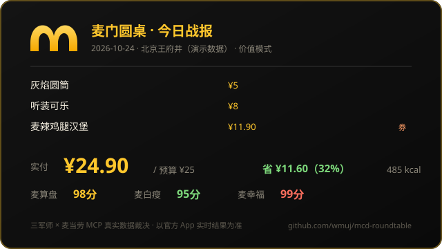

<div align="center">

# 麦门圆桌 · McRoundTable

**三个 AI 军师，用你钱包里的真实优惠券，吵出今晚最优的一顿麦当劳。**

[](LICENSE)
[](package.json)
[](package.json)
[](https://github.com/M-China/mcd-mcp-server)
[](https://github.com/wmuj/mcd-roundtable/actions/workflows/ci.yml)
[](test/selftest.js)


*麦当劳程序员创意开发大赛参赛作品 · 非麦当劳官方产品*

</div>

---

## 这是什么

每次打开麦当劳 App 都会陷入三个灵魂拷问：

1. **卡包里一堆积分券、满减券、1024"码"力翻倍券——今天哪张能用？哪张快过期？**
2. **预算 25 块，怎么点才能吃到 36 块的东西？**
3. **大模型口算价格经常翻车，谁来保证算对？**

麦门圆桌的答案是：开一场圆桌会议。

- **取数交给 [麦当劳官方 MCP](https://github.com/M-China/mcd-mcp-server)** —— 实时菜单、门店、你的真实券包、营养数据、核价接口，全部真数据；
- **算术交给确定性代码** —— 0/1 背包求解预算内最优组合，无 LLM、无随机数，同输入必同输出，可复现、可审计；
- **吵架交给三军师** —— 精算师、营养师、干饭人围着这单饭各执一词，台词全部由真实优化结果驱动。

## 30 秒上手

```bash
# 无需 Token，先看效果（内置真实数据快照）
npx github:wmuj/mcd-roundtable --demo

# 接入你的麦当劳 MCP Token，拉实时数据
MCD_MCP_TOKEN=你的Token npx github:wmuj/mcd-roundtable --budget 25 --city 北京 --keyword 王府井
```

真实运行输出（预算 ¥25 · 王府井门店 · 你的 8 张券）：

```
 【麦算盘·精算师】
 停。都别抢着说话。本单原价能吃到 36.50 元的东西，实付 ¥24.90，省下 ¥11.60（32%）。
 1 张券全部按券面价核过账，一分都不多花。

 【麦白瘦·营养师】
 我来翻译一下麦算盘的"性价比"：485 大卡、24g 蛋白质。这个组合能吃，但结构还行，记得配点蔬菜。

 【麦幸福·干饭人】
 人生苦短，麦门永恒。麦辣鸡腿汉堡在这张桌上，谁也别想把它换成水煮西兰花。

 【麦幸福·干饭人】
 等等——我看见「1024"码"力翻倍」券了！程序员节快乐，这单必须写进年度总结！

◆ 圆桌决议 ······································
  灰焰圆筒            ×1   ¥5.00   [小食甜品]
  听装可乐            ×1   ¥8.00   [饮品]
  麦辣鸡腿汉堡        ×1   ¥11.90  [券 11.9元麦辣鸡腿堡]
  ──────────────────────────────────────────
  实付 ¥24.90 / 预算 ¥25.00   省 ¥11.60（32%）
  营养 约 485 大卡 · 蛋白质 24g
  评分 麦算盘 98分  麦白瘦 95分  麦幸福 99分
```

## 三军师是谁

| 军师 | 立场 | 口头禅 | 数据来源 |
|---|---|---|---|
| 🧮 **麦算盘** · 精算师 | 每一分钱都要有去处 | "省下的钱才是这顿饭最好吃的部分" | 券面价 × 菜单原价 × 核价接口 |
| 🥗 **麦白瘦** · 营养师 | 蛋白质要够，钠要看紧 | "我不反对吃，我反对吃糊涂" | 营养成分接口（能量/蛋白/钠） |
| 🍔 **麦幸福** · 干饭人 | 人生苦短，麦门永恒 | "谁也别想把它换成水煮西兰花" | 你的必吃清单（--want） |

三军师不是随机台词机：**每句话里的数字都来自本轮真实优化结果**——省了多少、用了几张券、多少大卡、哪张券今天到期。换一天、换一家店、换一个预算，他们会说出完全不同的话。

## 它能回答的问题

| 你问 | 命令 | 军师给 |
|---|---|---|
| 25 块预算怎么吃最值？ | `--budget 25` | 预算内原价价值最大的组合 + 券用法 |
| 减脂期能怎么吃麦麦？ | `--mode light --budget 30` | 预算内蛋白质最大化的组合 |
| 就想吃巨无霸，怎么配最省？ | `--want 巨无霸 --budget 40` | 必含巨无霸的最优补全 |
| 今天有什么值得薅？ | `daily` | 积分过期预警 / 券到期预警 / 活动日历 |
| 战绩怎么晒？ | `--card card.svg` | 生成战报卡片，可嵌入 GitHub Profile |

## 工作原理

```
麦当劳 MCP Server (https://mcp.mcd.cn)
   │  query-meals / query-store-coupons / list-nutrition-foods
   │  query-nearby-stores / query-my-account / campaign-calendar ...
   ▼
数据装配层 ── 券↔商品编码匹配 · 营养名称模糊匹配 · 价格单位统一（分）
   ▼
确定性优化器 ── 0/1 背包（商品≤2份拆分 · 券各用一次）
   ├─ value 模式：预算内原价价值最大化（微惩罚偏好"少而扎实"）
   └─ light 模式：预算内蛋白质最大化（同蛋白质偏好更便宜）
   ▼
三军师圆桌 ── 槽位填充式台词生成（数据驱动，可复现）
   ▼
终端战报 + SVG 卡片（可嵌入 GitHub Profile README）
```

**为什么不用大模型算价格？** 因为「接口返回的价格单位是分」「券面价要从标题正则里抠」「券商品编码和菜单编码要对上」这些环节，LLM 口算不可靠。麦门圆桌把算术全部下沉到代码，LLM 想参与的话——欢迎在军师席加一个你的角色（见 `src/personas.js`，欢迎 PR）。

## 战报卡片：把麦门写进你的 GitHub Profile

```bash
npx github:wmuj/mcd-roundtable --demo --card card.svg   # 生成卡片
```

把 `card.svg` 提交到你的仓库，然后在 Profile README 里：

```markdown

```

配合仓库自带的 [`workflows/refresh-card.yml`](.github/workflows/refresh-card.yml)（GitHub Action 每日自动重跑、提交新卡片），你的 Profile 上就有一张每天自动更新的麦门战报。**这是属于程序员的今日限定周边。**

## 全部命令

```text
mcd-roundtable [选项]
  -b, --budget <元>     预算（默认 25）
  -s, --store <编号>    指定门店 storeCode（默认自动搜索）
      --city <城市>     门店搜索城市（默认北京）
  -k, --keyword <词>    门店搜索关键词（如 王府井 / 机场）
  -m, --mode <模式>     value=预算内价值最大化（默认）| light=蛋白质优先
  -w, --want <词>       必须包含的餐品关键词
      --card <文件>     生成 SVG 战报卡片
      --daily           今日麦门情报（积分/券到期/活动）
      --claim           一键领取麦麦省所有可领券
      --demo            离线演示模式（内置真实数据快照，无需 Token）
      --json            JSON 输出（方便接入你自己的 Agent）
      --seed <n>        固定军师语录随机种子

环境变量：MCD_MCP_TOKEN —— 在 https://open.mcd.cn/mcp 免费申请
```

> 外送场景、下单、支付：本项目**只读不下单**。算好组合后，去麦当劳 App 照着点即可——钱还是你自己付，军师只动嘴。

## 目标用户

- 每周至少吃一顿麦门、卡包里券比订单多的**打工人**
- 想看看 MCP + 确定性优化器怎么配合的 **AI 应用开发者**
- 需要一张会动的 Profile 战报卡的 **GitHub 重度用户**
- 正在参加 1024 程序员节活动、手里正好有"码"力翻倍券的**你**

## 麦当劳 MCP 集成

本项目实际调用的 MCP 工具、调用流程与业务价值详见 [MCP_INTEGRATION.md](MCP_INTEGRATION.md)。
接入配置示例见 [mcp-config.example.json](mcp-config.example.json)（Token 走环境变量，不落盘）。

## 边界与免责

- 项目输出仅供参考，不构成营养或医疗建议；餐品信息、价格及供应状态以麦当劳官方渠道实时结果为准；
- 演示模式数据为真实接口快照（已脱敏），仅用于展示，不代表你账号下的实时券包；
- 请妥善保管你的 MCP Token，本项目不会上传任何 Token（检查 `mcp-config.example.json` 与源码即可验证）。

## 参赛声明

本项目为麦当劳程序员节创意开发大赛参赛作品，声明见 [CONTEST_DECLARATION.md](CONTEST_DECLARATION.md)。

---

<div align="center">
<sub>如果这顿饭吃得更明白了，给个 Star 鼓励三军师继续开会 🍔</sub>
</div>
